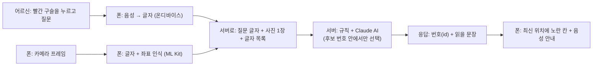

# 키우미 (kiumee) — 키오스크 앞에서 말로 묻는 AI 안내

> **"어? 이제 뭐 해야 되는 거야?"**
> 무인 키오스크 앞에서 막막해하는 어르신이, **폰 카메라로 키오스크 화면을 비추고 말로 물으면** AI가 지금 화면을 보고 **쉬운 말과 노란 테두리로 안내**하는 Android 앱입니다.

## 왜 만들었나
- 키오스크가 빠르게 늘었지만, 화면이 낯선 어르신은 **어디를 눌러야 할지 몰라** 주문을 포기하거나 뒤 사람 눈치를 봅니다 (디지털 소외).
- 키오스크 회사가 접근성 기능을 넣기를 기다리는 대신, **어떤 키오스크든 폰 하나로** 쓸 수 있게 했습니다. 키오스크를 바꾸거나 설치할 것이 없습니다.

## 설계 원칙 (사용자의 자율성을 지킨다)
1. **물어볼 때만 답한다.** 화면이 바뀌어도 앱이 혼자 떠들지 않습니다. 빨간 구슬을 눌러 물어볼 때만 그 순간의 화면을 보고 답합니다.
2. **대신 결정하지 않는다.** 메뉴, 방법, 결제 수단처럼 사용자가 정할 일은 말하지 않았으면 **선택지를 읽어 주며 되묻습니다.**
3. **대신 눌러 주지 않는다.** 앱은 키오스크를 조작하지 않고 **안내만** 합니다.
4. **끊을 수 있다.** 안내 음성 중에 구슬을 누르면 바로 멈춥니다.

## 한눈에 보기

- **서버는 좌표가 아니라 번호만 돌려줍니다.** 폰이 흔들려도 앱이 최신 프레임에서 같은 칸을 다시 찾아 칸이 따라갑니다. AI가 목록에 없는 번호를 말하면 서버가 걸러 냅니다.
- 음성과 글자 인식은 **폰 안**에서 하므로 소리는 서버로 가지 않습니다. 서버로 가는 것은 질문 글자, 그 순간의 사진 한 장, 글자 목록입니다.

## 사용한 기술
| 영역 | 기술 |
|---|---|
| 앱 | Kotlin 2.2, 코루틴, CameraX, **Google ML Kit 한국어 OCR**, 안드로이드 음성 인식(STT) · 음성 합성(TTS), 직접 만든 View 오버레이 |
| 앱 구조 | 7개 모듈(순수 Kotlin 상태 머신 `domain` + 어댑터), 순수 함수 `reduce(상태, 이벤트) → (다음 상태, 할 일)` |
| 서버 | Python 3.12, **FastAPI**, Pydantic v2, httpx, Pillow |
| AI | **Anthropic Claude Haiku 5.5**(사진 + 글자 목록 + 질문 → 정해진 응답 종류 중 선택, 구조화 출력), 오류 시 Gemini 대체 |
| 알고리즘 | 한글 자모 n-그램 유사도, 편집 거리, 지속 글자 창 기반 화면 구분, 중앙값 기반 움직임 추정, LRU 캐시, 헤지 요청, 화이트리스트 검증 |
| 배포 | Docker, **Google Cloud Run**(서울), Secret Manager |
| 검증 | JUnit(Android/JVM 345개), pytest(서버 439개), 합성 잡음 회귀 시험, 실제 손떨림 녹화 재생 |

## 실행해 보기
필요한 것: **JDK 17**, **Android SDK 37**, Python 3.10 이상, 카메라가 있는 **Android 8.0(API 26) 이상 폰**(USB 디버깅), 인터넷, Claude API 키(서버용).

**1) 서버** — 둘 중 하나를 고릅니다.
- **클라우드(권장, 폰만으로 동작)**: [server/deploy/README.md](server/deploy/README.md)의 스크립트 한 줄로 Google Cloud Run에 올립니다. 서버 주소와 앱 키가 `local.properties`에 자동으로 기록됩니다.
- **내 PC에서**:
  ```bash
  cd server && pip install -r requirements.txt
  APP_KEY=dev ANTHROPIC_API_KEY=sk-ant-... LLM_PROVIDER=anthropic uvicorn app.main:app --port 8080
  adb reverse tcp:8080 tcp:8080     # 폰이 PC 서버로 붙게 (USB 연결)
  ```
  Windows PowerShell이면 환경변수를 이렇게 줍니다: `$env:APP_KEY="dev"; $env:ANTHROPIC_API_KEY="sk-ant-..."; $env:LLM_PROVIDER="anthropic"; uvicorn app.main:app --port 8080`

**2) 앱** — [local.properties.example](local.properties.example)을 `local.properties`로 복사해 `sdk.dir`, `kl.serverUrl`, `kl.appKey`를 채웁니다(서버를 PC에서 돌리면 `http://127.0.0.1:8080`, 앱 키는 서버의 `APP_KEY`와 같은 값).
```bash
./gradlew :app:installDebug
```

**3) 사용법** — 키오스크 화면을 비추고 **아래 빨간 구슬을 누른 뒤 말합니다.** ("여기서 뭐를 눌러야 돼?", "블루베리 베이글 어딘지 알려줘", "이게 어떤 메뉴야?") 구슬이 하얀 호로 돌면 찾는 중이고, 파란 막대가 나오면 안내 음성입니다. 음성 중에 파란 구슬을 누르면 멈춥니다.

**테스트만 돌려 보려면** 키 없이도 됩니다: [빌드 · 테스트](#빌드--테스트) 참고 (`./gradlew test…`, `cd server && KL_SKIP_APP_INIT=1 pytest -q`).

## 동작 방식 (도움 모드가 기본, 2026-11-14)

- **어르신이 물어볼 때만 답한다.** 키오스크 화면이 바뀌어도 앱이 혼자 인식하고 설명하지 않는다.
- **빨간 구슬(말하기 버튼)을 누르고 물어보면**, 그 순간의 화면(카메라 사진 + 글자 인식)을 AI가 보고 답한다. 인식하는 동안 구슬 둘레를 하얀 호가 돈다.
- 눌러야 할 버튼이 있으면 **노란 테두리와 음성**으로 알려 주고, 화면이 무엇인지 · 왜 그 버튼인지 한 문장을 먼저 읽는다.
- **어르신이 정할 일은 대신 고르지 않는다.** 선택지가 여럿인데 말하지 않았으면 선택지를 읽어 주며 되묻는다. 동의 · 약관 버튼은 설명 없이 안내하지 않는다.
- **음성 안내 중(파란 구슬)에 구슬을 누르면 바로 멈춘다.** 노란 칸은 남고, 구슬이 빨갛게 돌아오면 다시 눌러 물어본다.
- 예전 방식(화면이 바뀔 때마다 자동 안내)은 앱 `kl.helpMode=false` + 서버 `HELP_MODE=false`로 켠다. **앱과 서버가 같은 모드여야 한다.**

## 처음 왔다면 이 순서로 읽기

1. **[docs/contract.md](docs/contract.md)** — 모듈 · 서버가 주고받는 규격 (계약 v1). 전원 필독
2. **자기 모듈 README** — 아래 표에서 자기 담당 모듈
3. [docs/decisions.md](docs/decisions.md) — 지금까지 정한 것과 아직 안 정한 것

## 모듈과 담당

| 모듈 | 담당 | 하는 일 | README |
|---|---|---|---|
| `:core-model` | P1 | 공용 데이터 + 포트(규격). 전원이 여기에 맞춰 개발 | [core-model](core-model/README.md) |
| `:domain` | P1 | 두뇌: 상태머신 · SessionRunner · 위치 문구 | [domain](domain/README.md) |
| `:app` | P1 | 조립(DI) · 화면(UI) · 카메라 연결 | [app](app/README.md) |
| `:vision` | P2 | 눈: 화면 글자 읽기 (OCR) · 화면 전환 감지 | [vision](vision/README.md) |
| `:voice` | P3 | 귀와 입: 음성 인식(STT) · 음성 안내(TTS) | [voice](voice/README.md) |
| `:agent` | P4 | 서버 클라이언트 | [agent](agent/README.md) |
| `server/` | P4 | 다음에 누를 버튼을 고르는 서버 (FastAPI + LLM) | [server](server/README.md) |
| `:overlay` | P5 | 손가락 표시: 좌표 변환 · 하이라이트 | [overlay](overlay/README.md) |

```
:app ──▶ 전부
:vision · :voice · :agent · :overlay ──▶ :domain ──▶ :core-model
```

- 어댑터(`:vision` · `:voice` · `:agent` · `:overlay`)끼리는 **서로 의존 금지**. 위반하면 빌드가 실패한다.
- `:core-model` · `:domain`은 순수 Kotlin 모듈이라 `import android...`를 쓰면 **컴파일이 안 된다**.

## 빌드 · 테스트

```bash
./gradlew :core-model:test :domain:test   # 순수 모듈 단위 테스트
```

```bash
./gradlew :vision:testDebugUnitTest :voice:testDebugUnitTest :agent:testDebugUnitTest :overlay:testDebugUnitTest :app:testDebugUnitTest   # Android 모듈 테스트
```

```bash
./gradlew :app:installDebug               # 연결된 기기에 설치 (플레이버 없음 — 항상 실구현)
```

```bash
cd server && pip install -r requirements-dev.txt && KL_SKIP_APP_INIT=1 pytest -q   # 서버 테스트
```

필요한 것: JDK 17 이상 · Android SDK **API 37** 플랫폼 (SDK Manager에서 설치) · `local.properties`에 `sdk.dir` (Android Studio로 열면 자동 생성) · 서버는 Python 3.10 이상 (CI 3.12)

## 구현 현황

| 모듈 | 상태 | JVM 테스트 |
|---|---|---|
| `:core-model` · `:domain` (+`SessionRunner`) | 구현 완료 · 안내 중 말하기 · 놓친 화면 전환 다시 묻기 · 서버 실패 3번까지 다시 묻기 · 노란 칸을 버튼 전체에(서버가 사진에서 본 칸을 글자에 붙여 따라가기, decisions.md 11장) · 도움 모드에서 안내 음성 중 구슬을 눌러 끊기 · 같은 안내를 15초마다 다시 읽지 않기 | 99개 (core-model 5 + domain 94) |
| `:agent` | 구현 완료 (직접 JSON, 시도 한 번 전체 6초, 실패 → 안내 문구 분류) | 24개 |
| `:vision` | P2 구현 (메가커피 화면 · 팝업 · 닫기 아이콘 · ID 유지) · 오타 허용 화면 구분 · 담은 목록 중복 제외 · 옵션 창(화면 일부 변화) 감지 · 팝업은 창 버튼만 · **화면 번호 안정화: 기준을 "최근 프레임에서 계속 읽히는 글자"로, 긴 글자는 길이에 비례해 오타 허용, 잡음 강도별 회귀 테스트** · 판단 근거 진단 로그(`KL_TRACK`) | 83개 (1개 건너뜀) |
| `:voice` | 구현 완료 · 한국어 온디바이스 모델이 없으면 일반 인식기로 폴백 (P3, 결정 #3) · 모델 없음을 미리 알고 조용할 때는 바로 들어 첫 말이 잘리지 않게 · 목소리 크기(마이크 버튼 파동용) | 23개 |
| `:overlay` | 구현 완료 (View 기반) · 위치 확인 화면(디버그 빌드) · 안 보임 신호 · 인식 표시 · 흔들림 따라가기 · 위치를 놓치면 숨기기 · 그리기 속도 재기 · 안내 테두리가 처음 나타날 때 그려지며 짚기 | 76개 |
| `:app` | 조립 · 카메라 (실구현만, 분석 1280×960) · Android 17 로컬 네트워크 권한 · **키우미 화면**: 상태를 보여 주는 마이크 구슬 하나 · 로딩 화면 · 조준 모서리 · 캐릭터 아이콘 (decisions.md 9장). 인식 표시는 `kl.showRecognition=true`일 때만 · 키오스크 화면 노출 낮추기(10장) | 40개 |
| `server/` | **Claude Haiku 5.5(생각 끔)가 사진 + 글자로 판단** · 버튼 전체 칸 · 목록에 없는 버튼(MISSING) (decisions.md 11장) · Claude 오류 때 Gemini가 대신 · 구조화 출력(후보 번호 묶기) · 겹쳐 보내기 · 응답 캐시 · 옵션 · 결제 수단 먼저 묻기 · 바뀐 화면 판단 · 진단 기록 · 고른 것 없이 '끝' · '결제'로 가지 않기 · **도움 모드(기본 켬)** · AI 설명 한 문장 전달(`say`) · 어르신 몫인 선택은 되묻기(모델이 `userChoice`로 직접 판단) · 동의 버튼 설명 | 439개 |

**Fake · mock 플레이버는 없다** (2일차 결정, [decisions.md](docs/decisions.md) 6장): 계약 테스트는 실구현으로 돌리고, JVM에서 못 도는 STT/TTS · ML Kit · 카메라는 기기에서 확인한다.
전체 빌드 · 테스트는 AGP 9.5 · SDK 37에서 처음부터 다시 돌려 통과를 확인했다 (2026-11-14: Android/JVM 345개 — core-model 5 · domain 94 · vision 83(1개 건너뜀) · voice 23 · agent 24 · overlay 76 · app 40 — 와 서버 439개).
에뮬레이터(Android 17)에서 실행 · 카메라 · ML Kit OCR · "말하기" 흐름 · 서버 연결도 확인했다. **실제 글자 인식과 음성 인식 성공 → 하이라이트 → 음성 안내는 실기기 확인이 필요하다.**
⚠️ 알려진 문제: 한국어 온디바이스 음성 모델이 없는 기기에서는 STT가 안 된다 → [voice/README.md](voice/README.md) "알려진 문제" (P3: 일반 인식기 폴백 수정안 작성, 검증 대기).

## 평가와 한계 (있는 그대로)

측정한 것과 측정하지 못한 것을 구분해 적는다. 숫자는 모두 2026-11-14, 실제 Claude(`claude-haiku-5-5`)와 이 저장소의 스크립트로 잰 것이다.

| 무엇을 | 결과 | 읽는 법 |
|---|---|---|
| 개발용 평가셋 22건 (`server/scripts/evaluate.py`) | 정확도 19~20/22 (86~91%), 지연 p50 약 1.2초 · p95 약 1.7초 | **개발하면서 보던 데이터라 낙관적인 숫자다.** 따로 떼어 둔 시험 세트는 아직 없다. 같은 설정을 다시 돌리면 1건이 오가는 무작위성이 있다 |
| 글자가 한 글자 깨진 버튼을 말한 그 버튼으로 알아보기 (새 낱말 5개 × 3회, 평가셋과 겹치지 않음) | 47~53% | **약점이다.** 모델이 "맞으실까요?"라고 되묻거나 규칙이 UNKNOWN/WAIT로 빠진다. 표본이 작고 원인 분석이 더 필요하다. 규칙을 더 얹지 않았다 |
| 정지 화면에서 화면 번호가 잘못 바뀐 횟수 (잡음 9개 설정 × 40시드, 합성) | 수정 전 10~40/40 → 수정 후 0~2/40 | 실기기 로그(`KL_TRACK`)에서 본 잡음(키보드 글자, 매번 다르게 깨지는 긴 줄)을 **흉내 낸 합성 데이터**다. 진짜 전환을 한 번만 8프레임 안에 잡은 횟수는 0~26/40 → 23~40/40. 실제 손떨림 녹화 재생 테스트(기존)도 통과한다 |
| 서버 HTTP 시험 (키 없음 401 · 잘못된 요청 400 · 카드번호 마스킹) | 통과 | 단위 테스트 439개와 같이 `server/tests`에 있다 |

**알려진 한계**
- **실기기 시험이 적다.** 자동 시험 대부분은 합성 · 녹화 데이터다. 실제 키오스크 여러 곳에서의 정확도는 측정하지 못했다. 시험은 PC 화면에 띄운 가상 체크인 화면과 메가커피 녹화로 했다.
- **키오스크 일반화는 부분적이다.** 비전의 장면 분류(`SceneProcessor`)와 서버의 카페 어휘(브랜드 표 · 화면 종류 · 동의어)는 코드에 들어 있다. 카페가 아닌 키오스크는 일반 경로로 처리되고 가상 체크인 화면으로 확인했지만 정량 평가는 없다. 이 지식을 데이터 파일로 분리하는 일이 남아 있다.
- **프롬프트 규칙이 쌓여 있다** (`server/app/prompt.py`, 약 40개 항목). 실기기에서 실패가 나올 때마다 늘었고, 규칙별 효과를 따로 재지 못했다.
- **평가 누수 위험.** 개발 중 평가셋의 실패를 보고 규칙을 만들었다. 모델을 학습시킨 것은 아니다(사전 학습된 모델을 프롬프트로 호출한다). 정직한 일반화 수치는 새 시험 세트가 있어야 나온다.
- 한국어 온디바이스 음성 모델이 없는 기기에서는 일반 인식기로 대신한다 ([voice/README.md](voice/README.md)).
- LLM 키는 서버에만 둔다. 앱에는 `X-App-Key`만 들어간다.

## 협업 규칙 (5일 계획 9장)

| 항목 | 규칙 |
|---|---|
| 브랜치 | `main`은 항상 빌드 가능. 기능 브랜치는 `feat/p2-ocr-pipeline` 형식. **`main`에 직접 push 금지** |
| PR | 반나절 이하 분량으로 작게. 지정 리뷰어 1명 승인 후 병합 |
| 포트 · 계약 변경 | `:core-model` 또는 `docs/contract.md`의 JSON 형식을 바꾸는 PR은 **전원 승인**. 계약 테스트도 같이 수정 |
| 병합 시간 | 매일 13:00 · 19:00. 긴급 수정은 P1 승인 시 예외 |
| 통합 빌드 | 19:00 병합 후 P1이 시연 기기에 설치 → 5분 데모 |
| 성능 로그 | 구간 시작 · 끝에 `KL_PERF` 태그 로그 |
| 비밀 정보 | LLM 키는 서버에만. 앱에는 `X-App-Key`만 |

리뷰어 지정

| PR 작성자 | P1 | P2 | P3 | P4 | P5 |
|---|---|---|---|---|---|
| 리뷰어 | P4 | P5 | P1 | P3 | P2 |

PR 리뷰 체크리스트 (설계서 16.12)
- **S** 바꿀 이유가 두 가지 이상인 클래스는 분리했는가?
- **O** 새 동작을 `if` / `when` 추가가 아니라 새 클래스로 해결했는가?
- **L** 계약 테스트가 실구현에서 통과하는가? (Fake는 두지 않는다. JVM에서 못 돌리는 부분은 기기 확인 항목을 PR에 적는다)
- **I** 주입받은 포트에 쓰지 않는 메서드가 있는가?
- **D** `:domain` · `:core-model`에 플랫폼 · 라이브러리 import가 생겼는가? 생성자 주입 외의 의존 획득이 있는가?

## 하루 리듬

| 시간 | 내용 |
|---|---|
| 10:00 | 스탠드업 10분: 어제 한 일 · 오늘 할 일 · 막힌 점 (P1 진행) |
| 13:00 | 1차 병합 |
| 19:00 | 2차 병합 → 통합 빌드 설치 → 5분 데모 |

## 폴더

```
core-model/  domain/  app/            P1
vision/                               P2
voice/                                P3
agent/  server/                       P4
overlay/                              P5
docs/            contract.md (계약) · decisions.md (결정 기록)
testdata/contract/   계약 예시 JSON — 앱과 서버가 같이 쓰는 정답지
```
